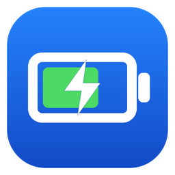

<p align="center"></p>

<h1 align="center">BatteryHub v1.0</h1>

<p align="center">
Battery levels of your wireless mouse, headset, keyboard and controller, right on the Windows taskbar.<br>
<b>Written in Rust 🦀</b>
</p>

> [!IMPORTANT]
> **This is a fork of [krisgfx9/Wireless-Device-Battery-Monitor](https://github.com/krisgfx9/Wireless-Device-Battery-Monitor)** (the C++ BatteryHub by krisgfx9).
> This fork rewrites it in Rust. The idea, the look of the taskbar strip and the device protocols all come from the original project, and the credit for them goes to its authors.
> It is not an official release of the original. For the full device list (about 100 drivers), use the original.

Developed by [@ferloom](https://github.com/ferloom) with the help of Claude (AI).

---

## Download

Get **`BatteryHub-Taskbar-Setup-v1.0.exe`** from the [**latest release**](../../releases/latest).

It shows `🎧 27%  🖱 32%` right on the taskbar, next to the clock. It runs in the background, refreshes on its own and can start with Windows. It does not interfere with the original C++ BatteryHub if you have that installed too.

## Setup: Install / Update / Uninstall

The setup is a console window with a detailed log. Before it shows any options, it **scans your PC**:

- whether BatteryHub is already installed, which version, and where;
- the program file (size and date), the desktop and Start menu shortcuts, autostart, and whether it is running;
- whether the original C++ BatteryHub is installed (it is reported, never touched).

Then it offers:

| Option | When it is available | What it does |
|---|---|---|
| **[1] Install** (or **Reinstall**) | always | Installs to the folder below, creates desktop and Start menu shortcuts and asks *"Add to Windows autostart? [Y/n]"*. Logs every block written (with CRC-32 check) and every file and registry entry it creates. |
| **[2] Update** | when an older version is installed | Replaces the program and keeps your settings and autostart choice. Restarts the program if it was running. |
| **[3] Uninstall** | when installed | Stops the program and checks every autostart location (HKCU/HKLM Run, RunOnce, Task Manager startup state, Startup folder) for entries that start it, then removes them along with the shortcuts, files and settings. Lists everything it removed. |

No administrator rights are needed (per-user install). Command line for scripts: `/install`, `/update`, `/uninstall`, `/S` (silent), `/autostart=yes|no`, `/nolaunch`.

### Where the files go

| | |
|---|---|
| Program | `%LOCALAPPDATA%\Programs\BatteryHub\Taskbar\batteryhub-taskbar.exe` |
| Desktop shortcut | `BatteryHub Taskbar.lnk` |
| Start menu shortcut | `Start Menu\Programs\BatteryHub\BatteryHub Taskbar.lnk` |
| Settings | `HKCU\Software\BatteryHub\Taskbar` |
| Autostart | `HKCU\...\Run` → `BatteryHub Taskbar` (if you chose it) |

The original C++ BatteryHub (`Program Files\BatteryHub`, `HKCU\Software\WirelessBattery`, autostart `WirelessBattery`) uses different names and is never touched.

## Using it

| | Meaning |
|---|---|
| **Red** percentage | At or below the device's warning level (default 15%) |
| **Green ⚡** | Plugged in and charging |
| **Blue ⚡** | Plugged in and charged to 100% |
| Dimmed | Asleep, showing the last known value |

- Shows one icon and percentage per device. The look follows the original: Segoe Fluent Icons, Segoe UI Variable text and ClearType, adapting to light and dark mode and DPI.
- Tooltip and menu colours follow the taskbar (dark or light).
- **Hover** over a device: a tooltip shows its name, level and charge state (charging, fully charged or on battery), the connection and its warning level.
- Left click does nothing.
- **Right click** opens this menu:
  - one submenu per device (name, level and state) with *Red warning at or below* 50 / 40 / 30 / 20 / 15 / 10 / 5%;
  - *Refresh devices* (full rescan, forgets devices that are gone) and *Refresh battery levels*;
  - *Refresh battery every* 1 minute / 5 / 10 / 30 minutes / 1 hour (default 1 minute);
  - *Refresh when a device connects or disconnects* (default on). It reads again about 2.5 s after a USB receiver, cable or Bluetooth device appears or disappears, and after the PC wakes up. A device that disconnected disappears right away.
  - *Exit*.

The settings are saved in `HKCU\Software\BatteryHub\Taskbar`: `Thresholds` (per device), `RefreshMinutes` and `RefreshOnDeviceChange`. Optional gap from the clock (DWORD, pixels): `TaskbarOffset`.

## Memory and CPU vs. the original

Measured on the same PC with the same devices, each program running on its own with default settings (details and raw samples in [bench/RESULTS.md](bench/RESULTS.md)):

| | **BatteryHub (Rust) 1.0** | BatteryHub (C++) 1.1.0 |
|---|---:|---:|
| Program file size | **368 KB** | 1,958 KB |
| Working set (steady) | **2.4 MB** | 29.4 MB |
| Working set during a read (peak) | **17.8 MB** | 29.8 MB |
| Private memory (steady) | **3.2 MB** | 5.6 MB |
| Handles / threads | **229 / 10** | 392 / 15 |
| CPU time per minute | **~0.02 s** | ~0.64 s |

How it gets there: Bluetooth LE listening only while reading, a cached device list (full rescan only when a device connects or disconnects), Bluetooth-only enumeration, Xbox input APIs loaded only when a controller is present, and memory handed back to Windows after each read. Details are in [bench/RESULTS.md](bench/RESULTS.md).

The original does more: about 100 drivers, battery history, an updater and more options. Part of the gap is that this fork has fewer features.

## Supported devices

| Family | Notes |
|---|---|
| Logitech | HID++ 1.0 / 2.0 over Unifying, Bolt, LIGHTSPEED, Bluetooth and USB, plus G headsets (voltage curves) |
| SteelSeries | Arctis 1/7/9/Pro, Arctis Nova (3P, 5, 7, 7+, Pro), GameBuds, Aerox, Prime, Rival |
| Razer | Mice, keyboards and receivers (90-byte feature report protocol) |
| Sony | DualShock 4, DualSense, DualSense Edge (USB and Bluetooth) |
| Apple | AirPods and Beats, from BLE proximity broadcasts (L / R / case) |
| Bluetooth | Any device Windows knows a battery level for, plus the Google Fast Pair L / R / case split |
| Generic HID | Devices exposing the standard Battery Strength usage |
| Xbox | Windows.Gaming.Input (exact %) and XInput (coarse levels) |

Other brands from the original project can be added as one file each in `src/drivers/`. Devices can be excluded with `HKCU\Software\WirelessBattery\IgnoreDevices` (`VID:PID` list, same as the original).

## Building from source

Requirements: Rust (stable, MSVC toolchain) and Visual Studio Build Tools with the Windows SDK. The SDK provides `rc.exe` for the icon.

```powershell
.\build-release.ps1
```

This builds the program, then the setup with the program embedded (`installer/`, `BH_PAYLOAD_DIR`), and writes `release\BatteryHub-Taskbar-Setup-v1.0.exe` plus `SHA256SUMS.txt`.

| Path | Contents |
|---|---|
| `src/` | Library: HID layer, device drivers, BLE watcher, settings, UI and setup helpers |
| `src/bin/taskbar.rs` | The taskbar program |
| `installer/` | The setup (`src/setup.rs`) |
| `res/` | Icon (`make_icon.py` draws it), manifest, resource script |
| `bench/` | Memory / CPU measurement script and results |
| `examples/list.rs` | Console diagnostics: `cargo run --example list -- --dump --ble` |

## License

GPL-3.0-or-later, same as the original project. See [LICENSE](LICENSE).
